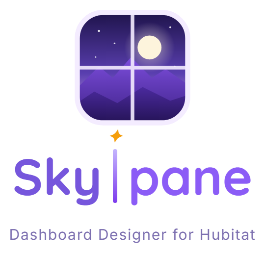

  

# Skypane

Skypane turns a wall tablet into a dashboard for your Hubitat home — lights, fans, locks, the thermostat, cameras,
calendars, the weather and an animated sky — and gives you the **Manager**, a web page where you set it all up from a
computer or a phone. Skypane was designed to be so easy that even a Jeremy could use it.

> **This is a tester build (3.0).** Things may still change. Stuck, or something broken? **Send feedback** in the
> Manager — it files the report for you. Can't reach the Manager? See [Troubleshooting](docs/troubleshooting.md).

**Setting it up takes about an hour:** 10 minutes to install, 10 to connect Hubitat, the rest for your panels and
tablets. You'll sign in to your Hubitat hub and your router (to give a few devices a fixed address), and you'll paste
one or two commands into a terminal. Every step is spelled out.

See it first: the live demo at https://skypane.huskyserver.us (nothing to install).

## What you need

- A **Hubitat** hub with the **Maker API** app (built into Hubitat and free; [the Hubitat guide](docs/hubitat.md) shows
  how).
- A machine that runs **Docker** and stays on — an Unraid server, a Synology NAS, or a Linux / Windows / macOS
  computer. It must be an **x86-64 (Intel / AMD)** machine: not a Raspberry Pi or an ARM NAS yet.
- **Access to your router's settings**, to give Skypane, the hub and each tablet a fixed address.
- **A computer for the setup.** The Manager works on a phone too, but Integrations and the layout builder need a
  computer.
- A **tablet** for the wall. On an Android tablet, the free **FreeKiosk** app keeps it on the dashboard, wakes the
  screen and speaks alerts. FreeKiosk is Android-only: on an iPad you use Safari, without screen wake or spoken alerts.
- Optional: UniFi Protect or any camera with an RTSP stream (the video link most IP cameras offer), a Google / iCloud /
  Outlook calendar link, and a weather device on your hub for the weather card and warnings (see
  [Weather in the Hubitat guide](docs/hubitat.md#4-weather-optional--warnings-and-the-weather-card-from-hubitat)).

## Install

| Where | Guide |
|---|---|
| Unraid | [docs/install-unraid.md](docs/install-unraid.md) — with a ready template |
| Docker or Docker Compose (any computer) | [docs/install-docker.md](docs/install-docker.md) |
| Synology | [docs/install-docker.md](docs/install-docker.md#synology) |

Then: [connect Hubitat](docs/hubitat.md) and follow the [first-run walkthrough](docs/first-run.md) — first sign-in, your
house, your first panel on the tablet. Something not working? [Troubleshooting](docs/troubleshooting.md). Updating
later: [docs/upgrade.md](docs/upgrade.md).

For Docker users: the image is `ghcr.io/almulder/skypane:latest` (or a fixed version such as `:3.0.0`).

What's new and what's known not to work yet: [CHANGELOG.md](CHANGELOG.md).

## Help

The Manager has its own help (the **?** on every page, or Help in the menu) — the same text is in
[docs/help.md](docs/help.md).

## Feedback

In the Manager: **Send feedback** (sidebar; on a phone: More). You see the whole report before it goes. Skypane adds
nothing from your house — no device names, addresses or passwords — only the Skypane version, the page, your browser
and a few counts; what you type is sent as you typed it, so leave out private details. Nothing is sent until you press
**Send**. Reports become public issues in this repository — anyone can read them.

## Support Skypane

Enjoying Skypane? It's built in the author's spare time — a coffee helps keep it going:
[Buy me a coffee](https://buymeacoffee.com/almulder).

## Licence

All rights reserved during the tester phase — see [LICENSE](LICENSE). Third-party parts and their licences:
[CREDITS.md](CREDITS.md).
