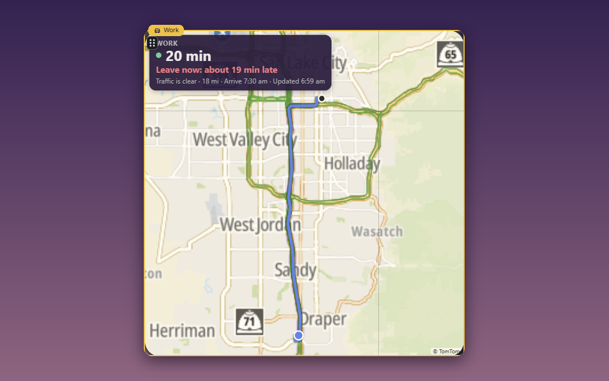

# Commute (Skypane plugin)

Your drive to work with live traffic on your Skypane panels: when to leave, when you'll arrive, how long the drive
takes right now and why it's slower than usual, with a map of the route and the traffic on it. It uses TomTom's map
services with your own free TomTom key.

**Download:** [commute-1.3.0.skyplugin](commute-1.3.0.skyplugin) · needs **Skypane 3.0.49 or newer**

## What you get

- **Leave by**: your arrival time minus the drive time now, minus your spare minutes for parking. Once that time has
  passed, the card says how late you'd be.
- **The drive right now**, with a coloured dot (green clear, amber some traffic, red heavy) and how much longer than
  usual it is.
- **Why it's slower**: what TomTom reports along your route, biggest delay first. That can be an accident, roadworks,
  a closed road, or heavy or rush-hour traffic. Each one says how far along the drive it is and how many minutes it
  adds.
- **A map** of your route with live traffic colours, in a day or night look and your choice of route colour. You can
  also choose **Times only**, which drops the map and shows the times bigger.
- **By car, bike or on foot.** Bike and walk use TomTom's bike and walking routes, without traffic.
- **The way home**: for an hour from a time you choose.
- **Only when it matters**: the card shows a drive from an hour before you need to leave until you arrive. The rest of
  the time it rests and says when the next drive will show, so nobody reads an old route.
- **Tap the card** to check right now (once a minute at most).
- **Up to 4 commutes**, one for each person or job.

## Set up

1. **Get a TomTom key.** Make a free account at developer.tomtom.com (no card needed), and copy the key from the
   dashboard, under Keys.
2. Install the plugin: **Manager → Integrations → Plugins → Install** (see [installing a plugin](../README.md)).
3. Open its tab, **Commute**. Paste your key into **TomTom key**, and pick miles or kilometres, the 12- or 24-hour
   clock and how often to check. Then **Save**.
4. **Add a commute** and fill in:
   - a name;
   - your home and work addresses, as you'd type them into a maps app;
   - the time you want to arrive (type times either way: 8:30 am or 17:45);
   - how you go;
   - your work days;
   - any spare minutes you need for parking;
   - optionally, a time to show the way home.
5. Press **Test**. It finds both addresses and tells you how long the drive takes right now.
6. In the layout builder, add a **Commute** card (Plugins group) and pick the commute.

## Good to know

- **How often it asks TomTom.** It only asks while a card shows a drive, and only if a card showing that commute was on
  screen in the last 15 minutes. Every panel uses the same answer, so more panels never mean more calls.
  - The drive time and traffic: every 5 minutes by default (2 at the most).
  - The street map: once a day.
  - One commute uses roughly 2,000 routes a month, far inside TomTom's free allowance (20,000 routes when this was
    written). Keep an eye on your usage in TomTom's dashboard if you add several commutes.
- **Your addresses** are sent to TomTom once, to find them on the map. After that, Skypane sends TomTom only their map
  points, which it keeps in the plugin's private data on your server. Your addresses, map points and key are never
  shown on a panel or written to Skypane's log. The map does show your route, so think about where your panels are.
- **What it connects to:** only `api.tomtom.com` over HTTPS (search, routing, map tiles and traffic tiles).
- **If TomTom can't be reached**, or the month's free allowance runs out, the card keeps showing the last drive time
  with a note over it.
- **Trains and buses** aren't something TomTom does.
- Check TomTom's terms for your use when you make the account. Not affiliated with TomTom.
- **Tested with** a real TomTom key: Search geocode v2, Routing calculateRoute v1, Map Display raster tiles v1 and
  Traffic raster flow tiles v4.

## The files

- `commute-1.3.0.skyplugin`: the package to install.
- `source/`: the package's source: the worker (`worker/tomtom.py` for TomTom's calls, `worker/commute_core.py` for
  the schedule, leave-by time and delay reasons, `worker/main.py` for the routes), the card and the words.
- `tests/`: a stand-in TomTom (`fake_tomtom.py`), unit tests (`test_core.py`), end-to-end tests through Skypane
  (`test_plugin_e2e.py`, set `SKYPANE_REPO` to a Skypane checkout) and a browser check of the card
  (`card/index.html`, served over HTTP). The tests never contact TomTom.
